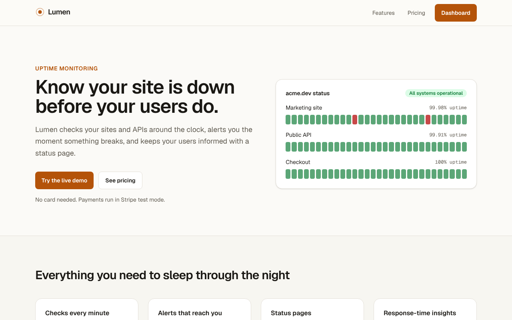
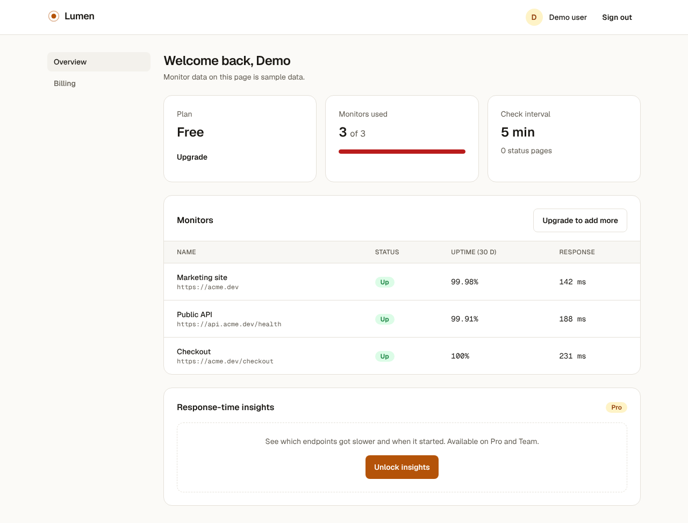
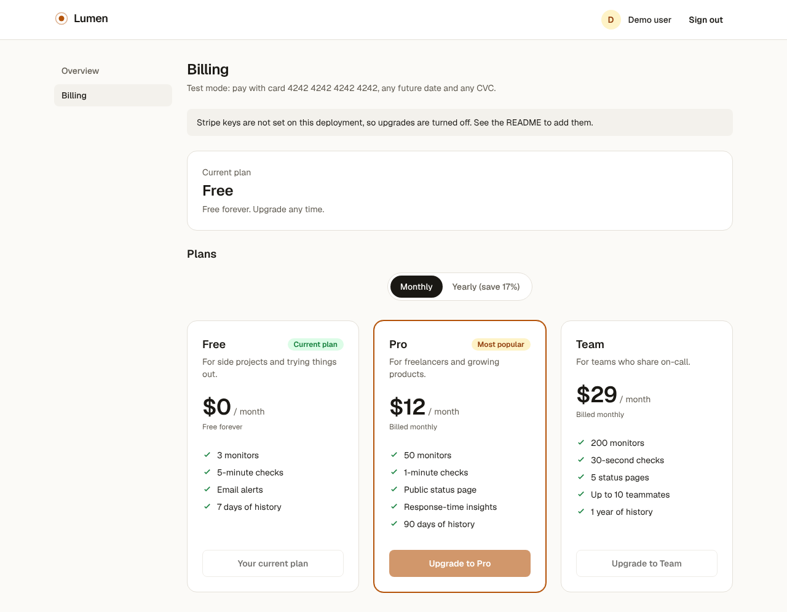
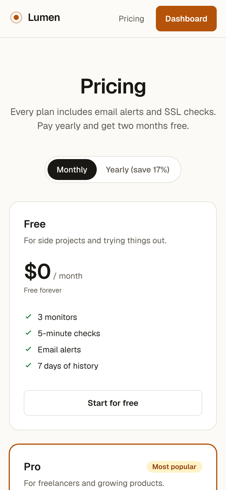
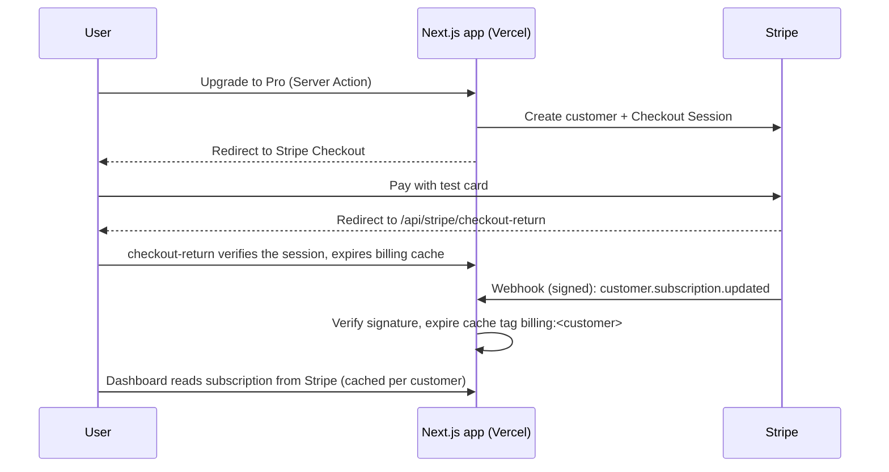

# Lumen SaaS: a Next.js SaaS starter

A subscription SaaS app built with the Next.js App Router, TypeScript and Stripe. It covers the parts every SaaS needs and most tutorials skip: sign-in, plan-gated features, Stripe Checkout, the customer portal, signed webhooks, SEO, accessibility and tests.

The demo product, **Lumen**, is a made-up uptime monitoring service. Sign-in and billing work for real. Monitor data is sample data, and Stripe runs in **test mode**, so no card is ever charged.

**Live demo:** [lumen-saas-kohl.vercel.app](https://lumen-saas-kohl.vercel.app) · Built by [Youssef Abotaleb](https://youssefabotaleb20.github.io/Portfolio/)

> On the live demo, Stripe and GitHub sign-in aren't configured yet, so use the demo account. The billing page shows "not configured" until Stripe test keys are added.



| Dashboard | Billing | Mobile |
| --- | --- | --- |
|  |  |  |

## What it does

- **Sign-in** with GitHub OAuth, or a one-click demo account. Each demo visitor gets a fresh account, so test checkouts never collide.
- **Plans and gating:** Free, Pro and Team with monthly or yearly billing. Limits and Pro-only features come from one typed plan config.
- **Stripe Checkout** for upgrades and the **Stripe customer portal** to switch plans, change cards or cancel.
- **Signed webhooks** keep the dashboard in sync when a subscription changes in Stripe.
- **SEO:** per-page metadata, canonical URLs, a generated Open Graph image, JSON-LD (`SoftwareApplication` and `FAQPage`), sitemap and robots.
- **Accessibility:** skip link, landmarks, keyboard-operable plan toggle, visible focus rings, reduced-motion support, and axe checks in CI on every page in light and dark mode.
- **Performance:** Partial Prerendering. Marketing pages are fully static. Dashboard pages send a static shell instantly and stream the signed-in parts.

## Stack

Next.js 16 (App Router, Cache Components, Server Actions, Route Handlers) · React 19 · TypeScript · Tailwind CSS 4 · Stripe · iron-session · Vitest and React Testing Library · Playwright and axe-core · GitHub Actions · Vercel

## How it works



Design choices worth knowing (the full reasoning, the security model and known limits are in [docs/ARCHITECTURE.md](docs/ARCHITECTURE.md)):

- **Stripe is the source of truth.** The app keeps no database. Subscriptions are read from Stripe and cached per customer with `use cache` and a cache tag. The webhook and the checkout return route expire that tag, so changes show up on the next request.
- **Prices are found by lookup key** (`lumen_pro_monthly` and so on), so there are no price IDs in env vars. `npm run stripe:setup` creates them.
- **Sessions are encrypted cookies** (iron-session). `src/proxy.ts` does a fast, optimistic redirect for signed-out visitors. The real check is in the data layer (`requireUser`), which every protected page and action calls.
- **No double subscriptions.** A paying user who picks another plan goes to the customer portal, not a second checkout.
- **Safe redirects.** `?next=` only accepts same-site paths, and OAuth uses a `state` cookie against CSRF.

## Project layout

```
src/
  app/
    (marketing)/          landing, pricing, sign-in (static or partly static)
    dashboard/            overview and billing (static shell + streamed content)
    actions/              Server Actions: sign-in, sign-out, checkout, portal
    api/auth/github/      OAuth start and callback
    api/stripe/           webhook and checkout return
    opengraph-image.tsx   generated social image
    sitemap.ts, robots.ts, manifest.ts
  components/             UI, pricing table, dashboard pieces
  lib/                    plans, billing, session, auth, Stripe client
  proxy.ts                optimistic auth redirect for /dashboard
scripts/stripe-setup.mjs  creates products, prices and the portal config
docs/                     ARCHITECTURE.md and README screenshots
tests/unit/               Vitest + React Testing Library
tests/e2e/                Playwright + axe
```

## Run it locally

Requires Node.js 20.9 or newer.

```bash
npm install
cp .env.example .env.local   # works as is: billing and GitHub sign-in are switched off
npm run dev
```

Open http://localhost:3000 and use **Continue with the demo account**.

### Environment variables

All are optional locally. See [`.env.example`](.env.example).

| Variable | Needed for | What it does |
| --- | --- | --- |
| `SESSION_PASSWORD` | Production | 32+ random characters that encrypt the session cookie. The app won't start in production without it |
| `NEXT_PUBLIC_SITE_URL` | SEO | Public URL for canonical links, the sitemap and Open Graph tags |
| `STRIPE_SECRET_KEY` | Billing | Stripe **test** secret key (`sk_test_...`). Unset switches billing off |
| `STRIPE_WEBHOOK_SECRET` | Billing | Signing secret of the webhook endpoint (`whsec_...`). Unset makes the webhook answer 501 |
| `GITHUB_CLIENT_ID` / `GITHUB_CLIENT_SECRET` | GitHub sign-in | OAuth app credentials. Unset leaves only the demo account |

### Turn on billing (Stripe test mode)

1. Create a free Stripe account and copy the **test** secret key (`sk_test_...`) into `STRIPE_SECRET_KEY`.
2. Create the products, prices and portal settings: `npm run stripe:setup`
3. Forward webhooks with the [Stripe CLI](https://docs.stripe.com/stripe-cli): `npm run stripe:listen`, then copy the `whsec_...` secret it prints into `STRIPE_WEBHOOK_SECRET`.
4. Restart `npm run dev`, open Billing and pay with `4242 4242 4242 4242`, any future date and any CVC.

### Turn on GitHub sign-in

Create an OAuth app at https://github.com/settings/developers with the callback URL `http://localhost:3000/api/auth/github/callback`, then set `GITHUB_CLIENT_ID` and `GITHUB_CLIENT_SECRET`.

## Tests

```bash
npm test            # unit and component tests (Vitest + React Testing Library)
npm run build && npm run test:e2e   # end-to-end and accessibility (Playwright + axe), desktop and mobile
npm run lint && npm run typecheck
```

GitHub Actions runs all of these on every push and pull request.

## Deploy on Vercel

The live demo runs on Vercel's free Hobby plan, linked to this repo, so every push to `main` redeploys.

1. Import the repository in Vercel.
2. Add the environment variables from `.env.example`. Generate `SESSION_PASSWORD` with `openssl rand -base64 32`.
3. In Stripe (test mode), add a webhook endpoint at `https://<your-domain>/api/stripe/webhook` for the `checkout.session.completed`, `customer.subscription.*` and `invoice.*` events, and put its signing secret in `STRIPE_WEBHOOK_SECRET`.
4. For GitHub sign-in, add a second OAuth app with the production callback URL.

## License

MIT
