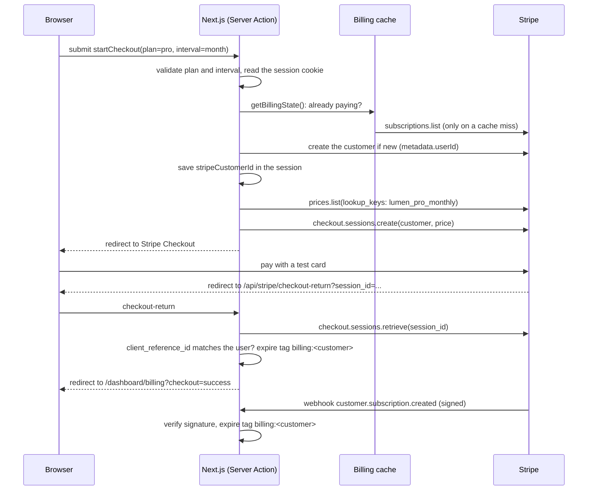

# Lumen architecture

This document explains how Lumen works under the hood and why it's built the way it is. The [README](../README.md) covers features, setup and deployment.

## The pieces

| Part | Where it runs | What it does |
| --- | --- | --- |
| Next.js app (`src/`) | Vercel Hobby (free, no card) | Marketing pages, sign-in, the dashboard, Server Actions for sign-in and billing, and Route Handlers for OAuth and Stripe. |
| Sessions | An encrypted cookie (iron-session) | Holds the signed-in user and their Stripe customer id. There's no session store. |
| Billing | Stripe, test mode | Customers, subscriptions, Checkout, the customer portal and signed webhooks. Stripe is the only place subscription data lives. |
| Sign-in | GitHub OAuth, or a one-click demo account | GitHub is optional. With no OAuth app configured, only the demo account is offered. |

There is no database. Monitor data on the dashboard is sample data from `src/lib/sample-data.ts`.

Both Stripe and GitHub are switched on by environment variables (`src/lib/env.ts`). With none set, the app runs with billing and GitHub sign-in shown as "not configured", which is how the live demo runs today.

## A request, end to end

Here's what happens when a signed-in user upgrades to Pro:

The checkout return route and the webhook both expire the same cache tag. Whichever arrives first makes the dashboard show the new plan; the other is harmless.

### Rendering

`cacheComponents` and Partial Prerendering are on. Marketing pages are fully static. Dashboard pages send a static shell at once and stream the signed-in parts inside `<Suspense>` boundaries. Billing state is cached per customer with `"use cache"`, `cacheTag("billing:<customer>")` and `cacheLife("minutes")`, so a dashboard visit usually doesn't call Stripe at all.

### Auth checks

1. `src/proxy.ts` runs before `/dashboard/*`. If there's no session cookie, it redirects to `/sign-in?next=...`. It doesn't decrypt anything; it's only a fast first check.
2. Every protected page and Server Action calls `requireUser()` (`src/lib/auth.ts`), which decrypts the cookie and redirects if there's no user. That's the real check.

## Data model

There are no tables. The data lives in two places:

| Data | Where | Shape |
| --- | --- | --- |
| Session | `lumen_session` cookie, encrypted, 7 days | `user { id, name, avatarUrl?, provider }`, `stripeCustomerId?` |
| Customer | Stripe | `metadata.userId` links it to `github:<id>` or `demo:<uuid>` |
| Subscription | Stripe | The price's `lookup_key` (`lumen_{pro,team}_{monthly,yearly}`) says the plan and interval |
| Plans | `src/lib/plans.ts` | Names, prices, features and limits, typed, shared by the pricing page, the dashboard and gating |

`toBillingState()` (`src/lib/subscription.ts`) turns a customer's subscriptions into one plan. It picks the live subscription (active, then trialing, then past due) whose lookup key belongs to Lumen, marks it "canceling" when it ends at period end, and falls back to Free for anything else.

## Security model

- **Sessions** are iron-session cookies: encrypted and signed, `httpOnly`, `sameSite=lax`, `secure` in production. The app refuses to start in production without a `SESSION_PASSWORD` of at least 32 characters.
- **Authorization is checked in the data layer.** The proxy redirect is a convenience; `requireUser()` runs in every protected page and action.
- **OAuth** uses a random `state` stored in a short-lived cookie scoped to `/api/auth/github`, and the callback rejects a mismatch.
- **Open redirects:** `?next=` only accepts same-site paths (`safeNextPath`), so `//evil.com` or `/\evil.com` fall back to `/dashboard`.
- **Stripe webhooks** are verified with `STRIPE_WEBHOOK_SECRET` before anything happens. Without the secret the endpoint answers 501.
- **Checkout return** only trusts a Checkout Session whose `client_reference_id` matches the signed-in user, so one user can't attach another's session.
- **No double subscriptions:** a paying user who picks another plan is sent to the customer portal, not a second checkout.
- **Security headers** on every response: `nosniff`, `X-Frame-Options: DENY`, a strict referrer policy and a locked-down permissions policy. `X-Powered-By` is off.
- **Secrets** live only in Vercel's environment settings. Stripe is in test mode, so no real card is ever charged.

## Key decisions

| Decision | What we chose | What we rejected, and why |
| --- | --- | --- |
| Where subscriptions live | Stripe is the source of truth, read through a per-customer cache that webhooks expire | **A database copy of each subscription:** another service to host, and a sync that can drift. For a starter, Stripe's API plus a cache is enough. |
| Finding prices | Lookup keys (`lumen_pro_monthly`), created by `npm run stripe:setup` | **Price ids in env vars:** six variables to copy between test and live mode, and easy to get wrong. |
| Sessions | Encrypted cookies (iron-session) | **NextAuth/Auth.js:** more than two sign-in methods need, and it wants a database adapter for anything beyond JWTs. **A session table:** no database to put it in. |
| Demo sign-in | A fresh demo user per visitor | **One shared demo account:** visitors' test checkouts would overwrite each other. |
| Auth redirect | `proxy.ts` for a fast redirect, `requireUser()` for the real check | **Only the proxy:** it can't safely decrypt sessions on every request, and a matcher mistake would expose a page. |
| Rendering | Partial Prerendering with Cache Components | **Fully dynamic dashboard pages:** slower first paint for no gain, since the shell is the same for everyone. |
| Hosting | Vercel Hobby (free, no card) | **Paid hosting:** the brief was zero spending. Vercel Hobby is for non-commercial use, which fits a portfolio demo but not a real paid product. |
| Tests | Vitest and React Testing Library for logic and components, Playwright with axe for flows and accessibility | **Testing against live Stripe in CI:** needs keys in CI and is slow. The billing logic that matters (lookup keys, picking the live subscription, webhook verification) is unit-tested, with webhook signatures made from a test secret and no calls to Stripe. |

## Testing strategy

- **Unit and component tests** (`tests/unit/`): plan maths and lookup keys, `toBillingState()` across subscription statuses, the webhook route (missing and forged signatures, cache expiry on a signed event), safe redirects, and the pricing table (monthly/yearly toggle, keyboard use, portal instead of a second checkout, disabled when billing is off).
- **End-to-end tests** (`tests/e2e/`): Playwright on desktop and mobile, covering the marketing pages, SEO basics, robots and sitemap, the skip link, the sign-in redirect, demo sign-in and sign-out, the Free plan on the billing page, and forged `?next=` values. axe checks run in light and dark mode.
- **CI** (GitHub Actions) runs lint, typecheck and unit tests, then builds the app and runs the end-to-end tests, on every push and pull request.

## Known limits

- **Billing is switched off on the live demo** until Stripe test keys and the webhook secret are added in Vercel. Until then the billing page shows "not configured" and no checkout can start.
- **GitHub sign-in is off on the live demo** until an OAuth app is configured. The demo account works.
- **Monitor data is sample data.** Lumen is a SaaS starter, not a working uptime monitor.
- **Demo accounts don't persist.** Signing out loses the demo user and its Stripe customer, which stays in Stripe test mode.
- **A GitHub user on a new device is found with Stripe customer search,** which can lag a few seconds behind a new customer.
- **Plan limits are shown but not enforced,** since there are no real monitors to count.
- **No team accounts.** The Team plan lists seats, but there's no invite flow.

## What I'd do next

1. **Turn on Stripe test mode on the live demo** (keys, `npm run stripe:setup`, webhook) and run a test checkout.
2. **Add a small database** (for example a free Postgres) once there's real data to store, such as monitors and team members.
3. **Team invites and roles** for the Team plan.
4. **Usage-based limits** enforced in Server Actions, with an upgrade prompt when a limit is reached.
5. **Email** for receipts and failed payments, using Stripe's own emails first.
